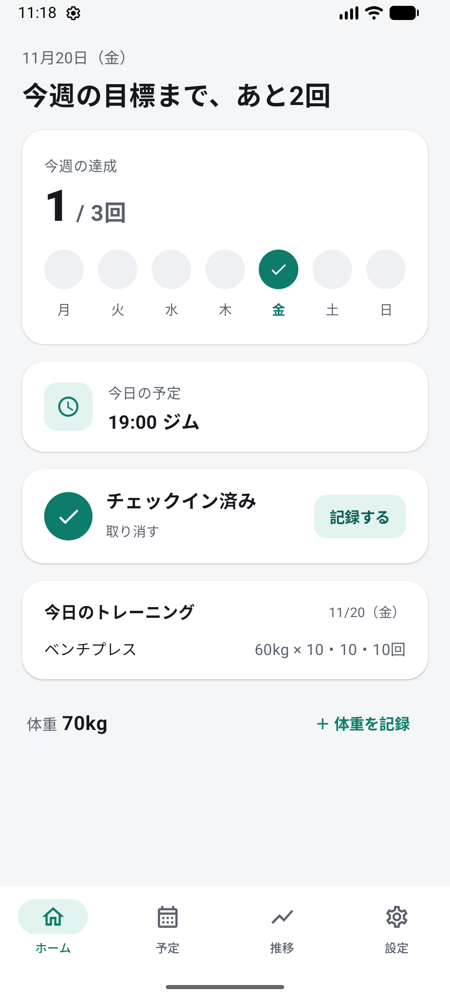
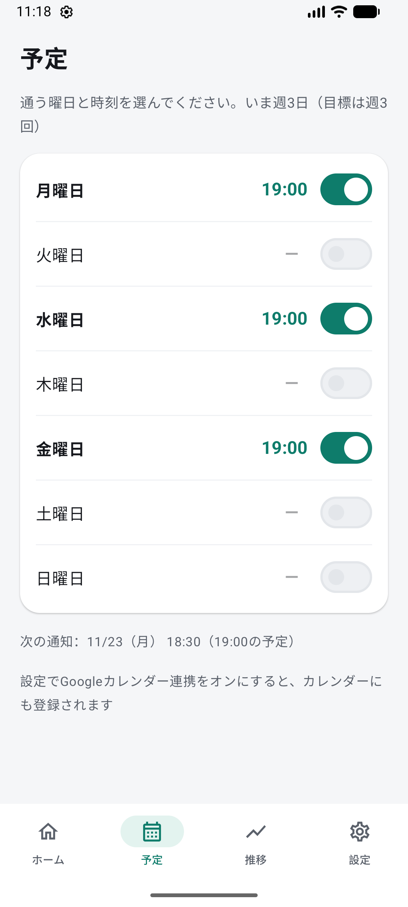
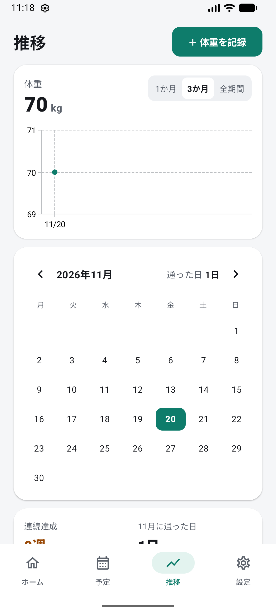

# muscle-habit

週3回のジム通いを習慣にするための、自分専用の Android アプリ（アプリ名「MuscleHabit」）。
設計書：Claude Docs「ジム習慣化アプリ 設計書（Android / Kotlin）」、画面イメージ：「ジム習慣化アプリ 画面イメージ」。

リポジトリ：https://github.com/momoree/muscle-habit

## スクリーンショット

| ホーム | トレーニング記録 | 予定 |
| --- | --- | --- |
|  |  |  |
| 今週の達成と連続週数、今日の予定、チェックイン、今日のトレーニング、体重 | 種目を選んで重量と回数を入れ、セットを追加。マイメニューと「前回と同じ」 | 通う曜日と時刻。次の通知の時刻も出る |

| 推移 | 設定 |
| --- | --- |
|  |  |
| 体重のグラフと、通った日のカレンダー | 週の目標、通知のタイミング、通知が届くかの確認、Googleカレンダー連携 |

## 構成

| モジュール | 中身 |
| --- | --- |
| `shared` | Kotlin Multiplatform（jvm）。達成率・連続週数・次の通知時刻・表示用の文字列。PC版（フェーズ2）からも使う |
| `androidApp` | Jetpack Compose + Material 3、Hilt、Room、DataStore、Vico、AlarmManager、CalendarContract |

`androidApp/src/main/kotlin/com/oashobi/musclehabit/` の中：

- `data/` Room のエンティティ・DAO、リポジトリ、設定（DataStore）、同梱の種目（`assets/exercises.json`）
- `domain/` チェックイン・パスと通知の後片付け
- `notify/` 通知、アラーム登録、通知ボタン・再起動の受け口
- `calendar/` Googleカレンダー（端末のカレンダー）への書き込み
- `ui/` ホーム・予定・推移・設定・種目の管理、トレーニング記録シート、体重入力

## ビルドと実行（VS Code のターミナル / PowerShell）

```powershell
.\gradlew :shared:jvmTest            # ロジックの単体テスト
.\gradlew :androidApp:assembleDebug  # APK を作る
.\gradlew :androidApp:installDebug   # つないだ端末に入れる
```

ログは `adb logcat`。adb は `%LOCALAPPDATA%\Android\Sdk\platform-tools` にある。

## 設計書の未決事項の決定

- 「今日はパス」は記録に残す（`VisitType.PASS`、週の回数には数えない）
- 予定外の曜日に行った日も週の回数に数える
- 体脂肪率は任意で入力できる

## 設計書から変えたところ

- 正確なアラームの権限：Android 13 以降は `USE_EXACT_ALARM`（インストール時に自動で許可）、12 は `SCHEDULE_EXACT_ALARM`。Android 14 以降で設定画面から許可する手間がない（Play ストアに出さない自分専用アプリなので可）
- `WorkoutGroupItemEntity.order` は SQL の予約語なので `position` にした
- 種目の並べ替えは手動ではなく、記録を保存するたびに「よく使う順」に付け直す
