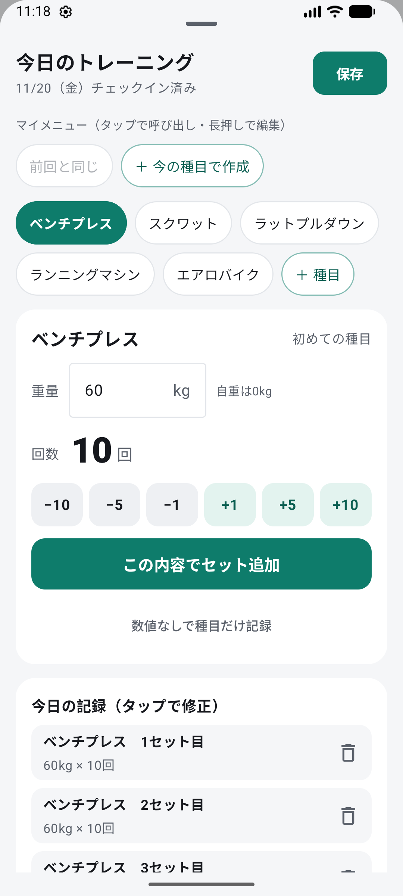
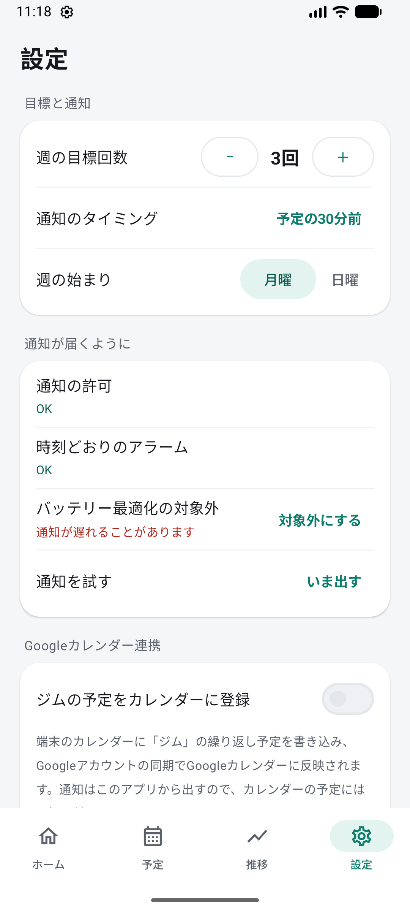

# muscle-habit

週3回のジム通いを習慣にするための、自分専用の Android アプリ（アプリ名「MuscleHabit」）。
設計書：Claude Docs「ジム習慣化アプリ 設計書（Android / Kotlin）」、画面イメージ：「ジム習慣化アプリ 画面イメージ」。

リポジトリ：https://github.com/momoree/muscle-habit

## スクリーンショット

| ホーム | トレーニング記録 | 予定 |
| --- | --- | --- |
|  |  |  |
| 今週の達成と連続週数、今日の予定、チェックイン、今日のトレーニング、体重 | 種目を選んで重量と回数を入れ、セットを追加。マイメニューと「前回と同じ」 | 通う曜日と時刻。次の通知の時刻も出る |

| 推移 | 設定 |
| --- | --- |
|  |  |
| 体重のグラフと、通った日のカレンダー | 週の目標、通知のタイミング、通知が届くかの確認、Googleカレンダー連携 |

## 構成

| モジュール | 中身 |
| --- | --- |
| `shared` | Kotlin Multiplatform（jvm）。達成率・連続週数・次の通知時刻・後押しの文面・準備通知の時刻・同期の JSON の型。スマホと PC の両方で使う |
| `androidApp` | Jetpack Compose + Material 3、Hilt、Room、DataStore、Vico、AlarmManager、CalendarContract、WorkManager + Ktor Client（PC 同期） |
| `desktopApp` | PC 版（フェーズ2）。Compose for Desktop（トレイ常駐・通知・閲覧画面）、Ktor Server（同期 API）、Exposed + MySQL |

`androidApp/src/main/kotlin/com/oashobi/musclehabit/` の中：

- `data/` Room のエンティティ・DAO、リポジトリ、設定（DataStore）、同梱の種目（`assets/exercises.json`）
- `domain/` チェックイン・パスと通知の後片付け
- `notify/` 通知、アラーム登録、通知ボタン・再起動の受け口
- `calendar/` Googleカレンダー（端末のカレンダー）への書き込み
- `sync/` PC への同期（ペアリング・未送信分の送信・Wi-Fi のときだけ動く WorkManager）
- `ui/` ホーム・予定・推移・設定・種目の管理、トレーニング記録シート、体重入力

## ビルドと実行（VS Code のターミナル / PowerShell）

```powershell
.\gradlew :shared:jvmTest            # ロジックの単体テスト
.\gradlew :androidApp:assembleDebug  # APK を作る
.\gradlew :androidApp:installDebug   # つないだ端末に入れる
.\gradlew :desktopApp:test           # PC 版のテスト（MySQL の代わりに H2 を使う）
.\gradlew :desktopApp:run            # PC 版を起動する
.\gradlew :desktopApp:packageMsi     # PC 版のインストーラー（.msi）を作る
```

ログは `adb logcat`。adb は `%LOCALAPPDATA%\Android\Sdk\platform-tools` にある。

## 設計書の未決事項の決定

- 「今日はパス」は記録に残す（`VisitType.PASS`、週の回数には数えない）
- 予定外の曜日に行った日も週の回数に数える
- 体脂肪率は任意で入力できる

## 設計書から変えたところ

- 正確なアラームの権限：Android 13 以降は `USE_EXACT_ALARM`（インストール時に自動で許可）、12 は `SCHEDULE_EXACT_ALARM`。Android 14 以降で設定画面から許可する手間がない（Play ストアに出さない自分専用アプリなので可）
- `WorkoutGroupItemEntity.order` は SQL の予約語なので `position` にした
- 種目の並べ替えは手動ではなく、記録を保存するたびに「よく使う順」に付け直す

## フェーズ2

### スマホに足した機能

- **最小目標モード**：ホームの「着いただけでOKにする」で、ジムに着いたら成功として記録する（`VisitType.MINIMUM`、週の回数に数える）。推移のカレンダーでも分かる
- **前日の準備リスト**：ジムの日の前の晩（初期値 21:00）に持ち物を通知し、ホームにチェックリストを出す。時刻と持ち物は設定で変えられる
- **未達時の後押し**：ホームの見出しと通知の文面で残りを伝える。今週中に届かない回数になったら、回数は言わずに「行けた分だけ前進です」と伝える

### PC 版（desktopApp）

PC は「通知」と「記録の閲覧」だけを担当し、入力はスマホで行う。スマホ → PC の片方向で、家の Wi-Fi の中だけで通信する。

1. MySQL に `sql/setup.sql` を実行して、データベース `musclehabit` とユーザーを作る（パスワードは自分で決めて書き換える）。テーブルは PC アプリが起動時に作る。手で作るなら `sql/schema.sql`
2. `.\gradlew :desktopApp:packageMsi` で作った `desktopApp\build\compose\binaries\main\msi\MuscleHabit-1.0.0.msi` を入れる（試すだけなら `.\gradlew :desktopApp:run`）
3. PC アプリの「設定」で MySQL のユーザー名とパスワードを入れる。「Windows のログイン時に起動する」をオンにする
4. 初回はファイアウォールの確認が出るので、「プライベート ネットワーク」だけ許可する
5. PC アプリの「スマホとつなぐ」に出る IP アドレスと6桁のコードを、スマホの「設定 → PC と同期 → つなぐ」に入れる

設定は `%APPDATA%\MuscleHabit\config.properties` に保存する（MySQL のパスワード・ペアリングのトークンを含む）。

同期の API（ポート 8765）：`GET /health`、`POST /pair`（コードを確かめてトークンを返す）、`POST /sync`（未送信の予定・チェックイン・体重と設定をまとめて受け取り、同じ id は上書き）。

### 設計書から変えたところ（フェーズ2）

- MySQL は設計書の 8 ではなく、この PC に入っている **5.7** を使う（使う機能は 5.7 で足りる）
- PC の通知と閲覧画面に要るので、設定（週の目標・通知の時間・週の始まり）も同期で送り、`app_settings` テーブルに保存する
- PC の IP アドレスはペアリングのときに入力するので、スマホの network security config は特定の IP に絞れず、暗号化なしの通信をアプリ全体で許可している（つなぐ先は自宅の PC だけ）
